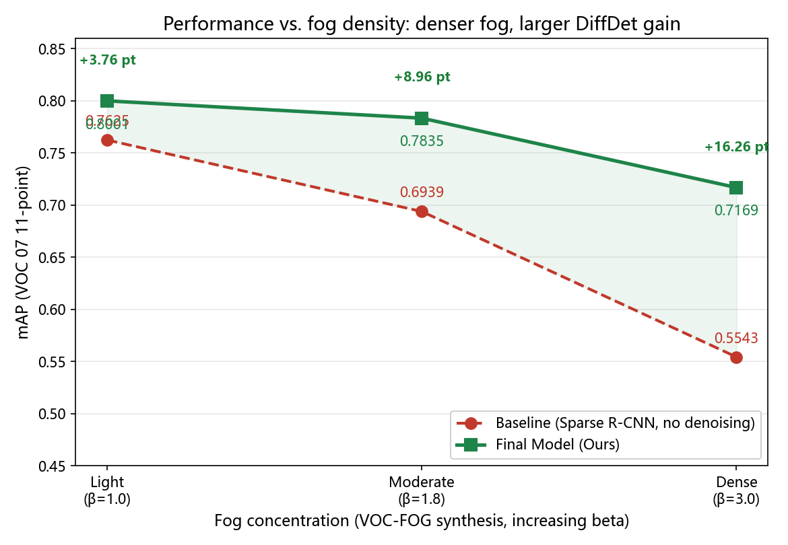
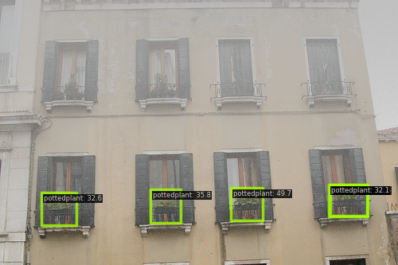

# DiffDet

**DiffDet: Foggy Object Detection through Lightweight Feature-Space Denoising**

Official code release for the DiffDet paper.

> **Status:** Submitted manuscript / Code release. This repository is a
> research code release and is **not** affiliated with a peer-reviewed
> publication yet. No acceptance status, publication date, or DOI is implied.

---

## Overview

Foggy weather degrades the high-level features of a detector, sharply reducing
detection accuracy. DiffDet addresses this by injecting a **lightweight residual
feature-denoising U-Net** at the **C5** position of a **Sparse R-CNN**
(ResNet-50 + FPN) detector. The denoiser performs a **single-pass,
diffusion-inspired** feature correction

```
x' = x + U(x)
```

where `U` is a small U-Net that predicts an additive correction to the foggy C5
feature. The corrected feature is then fed into the FPN and the standard
Sparse R-CNN head.

**Main contributions**

1. A plug-and-play **feature-denoising module** at C5 that requires **no change**
   to the detector head and preserves all output shapes.
2. A **feature-residual analysis** showing that fog induces strongly **non-Gaussian,
   heavy-tailed** feature residuals (skewness ≈ −10.24, excess kurtosis ≈ 385),
   motivating the learned (non-linear) correction.
3. **Teacher–student distillation** that compresses the denoiser from ~4.58 M to
   ~0.79 M parameters (**17.2%**) with λ = 1.0 and a validation MSE of ~0.0455.
4. **Weight-only INT8 quantization** (W8A32 simulation) for deployment.

> **Important terminology.** DiffDet is *diffusion-inspired* — it borrows the
> "recover a clean signal from a corrupted one" idea, but it is **not** an
> iterative DDPM. The code contains **no** diffusion timesteps, noise schedule,
> or reverse sampling.

## Method

> The author's own as-submitted architecture diagram is provided at
> `assets/architecture/arch_diffdet_ieee_as_submitted.png`; the dataflow is
> also described below.

```
foggy image -> ResNet-50 -> C5 (2048) -> [ + U(C5) ] -> FPN -> Sparse R-CNN
                                ^                         ^
                                |       C2/C3/C4          |
                                +--------(unchanged)------+
```

The denoiser is inserted between the ResNet-50 **C5** output and the **FPN**
input. Only C5 is denoised; C2/C3/C4 are passed through unchanged, so the
detector's neck and head are completely untouched. See
[`docs/METHOD.md`](docs/METHOD.md) for the full description.

| Component | Detail |
|---|---|
| Detector | Sparse R-CNN (ResNet-50 + FPN) |
| Denoiser input | C5, 2048 channels |
| Channel reduction | 1×1 conv, 2048 → 128 |
| U-Net | 2-level, base 32 (student) / 128 (teacher) |
| Channel restoration | 1×1 conv, 128 → 2048 |
| Fusion | residual `x' = x + U(x)` |

## Installation

```bash
# 1. create environment
conda env create -f environment.yml
conda activate diffdet

# 2. install mmdetection (required: importing `diffdet` registers DiffDetDetector
#    in the mmdet MODELS registry, so mmdet/mmcv/mmengine are hard dependencies)
mim install mmdet
```

```bash
# 3. make the `diffdet` package importable (from this repo root)
pip install -e .
```

Verified versions: Python 3.10, PyTorch 2.7.1, mmdet 3.3.0, mmcv 2.1.0,
mmengine 0.10.7.

## Dataset preparation

DiffDet uses **VOC-FOG**, a synthetic-fog variant of PASCAL VOC.

**Pre-built VOC-FOG is distributed with the `v0.1.0` release** (so the exact
evaluation images survive even if the local working copy is deleted):

| File | Content | Size |
|---|---|---|
| `voc_fog_light.tar.gz` | β=1.0, VOC2007 val (2,510 images) | 186.73 MB |
| `voc_fog_moderate.tar.gz` | β=1.8, VOC2007 trainval (5,011 images) | 333.56 MB |
| `voc_fog_dense.tar.gz` | β=3.0, VOC2007 val (2,510 images) | 142.78 MB |

```bash
mkdir -p data/VOC-FOG
for lvl in light moderate dense; do
  mkdir -p data/VOC-FOG/$lvl
  tar -xzf voc_fog_$lvl.tar.gz -C data/VOC-FOG/$lvl
done
```

The underlying **PASCAL VOC2007 / VOC2012** images are *not* redistributed
(they are third-party data). Download them from the official source and/or the
public mirror, then rebuild VOC-FOG from scratch if you prefer:

```bash
python tools/prepare_voc_fog.py \
    --voc-root data/VOCdevkit/VOC2007 \
    --out-root data/VOC-FOG \
    --levels light moderate dense --seed 42
```

Fog strengths: light β=1.0, moderate β=1.8, dense β=3.0. Evaluation uses the
VOC2007 **val** split (2510 images, 20 classes, 500×375) with the **VOC07
11-point mAP** metric.

> **Every dataset — official download URL, SHA256 checksums, directory layout,
> synthetic-fog parameters, and the exact commands to rebuild each split — is
> documented in [`docs/DATASETS.md`](docs/DATASETS.md).** Read it before the
> local `data/` directory is removed. Also see
> [`docs/REPRODUCIBILITY.md`](docs/REPRODUCIBILITY.md).

## Training

```bash
# Baseline Sparse R-CNN
python tools/train_detector.py configs/baseline/sparse_rcnn_r50_fpn_300_proposals.py \
    --work-dir work_dirs/sparse_rcnn_r50_fpn_300_proposals

# Teacher U-Net (feature-space denoising, base=128)
python tools/analyze_residuals.py \
    --clean-dir data/VOCdevkit/VOC2007/JPEGImages \
    --fog-dir data/VOC-FOG/moderate/VOC2007/JPEGImages \
    --names data/VOCdevkit/VOC2007/ImageSets/Main/val.txt \
    --out-dir work_dirs/phase1/residuals \
    --save-features work_dirs/phase1/clean_haze_features.pt
python tools/train_teacher.py --features work_dirs/phase1/clean_haze_features.pt \
    --out work_dirs/phase1/unet_minimal_b128.pt --base 128

# Student distillation (λ=1.0, 50 epochs)
python tools/train_student.py --features work_dirs/phase1/clean_haze_features.pt \
    --teacher work_dirs/phase1/unet_minimal_b128.pt \
    --out work_dirs/phase2/unet_student_c128_b32.pt

# Joint fine-tuning (detector + U-Net)
python tools/train_detector.py \
    configs/diffdet/sparse_rcnn_r50_fpn_300_proposals_diffdet_finetune.py \
    --work-dir work_dirs/finetune_diffdet

# Merge the deployment checkpoint (U-Net weights quantized to INT8, W8A32)
python tools/merge_final_model.py \
    --detector work_dirs/finetune_diffdet/epoch_3.pth \
    --out checkpoints/sparse_rcnn_voc_rainfog_final_int8.pth
```

## Evaluation

```bash
# DiffDet final checkpoint (INT8 U-Net embedded, no dynamic U-Net loading)
python tools/evaluate.py \
    configs/diffdet/sparse_rcnn_r50_fpn_300_proposals_diffdet_final.py \
    --checkpoint checkpoints/sparse_rcnn_voc_rainfog_final_int8.pth

# Same checkpoint on light / dense fog
python tools/evaluate.py \
    configs/diffdet/sparse_rcnn_r50_fpn_300_proposals_diffdet_final_light.py \
    --checkpoint checkpoints/sparse_rcnn_voc_rainfog_final_int8.pth
python tools/evaluate.py \
    configs/diffdet/sparse_rcnn_r50_fpn_300_proposals_diffdet_final_dense.py \
    --checkpoint checkpoints/sparse_rcnn_voc_rainfog_final_int8.pth

# Sparse R-CNN baseline (use *_fog_light / *_fog_dense for the other levels)
python tools/evaluate.py \
    configs/baseline/sparse_rcnn_r50_fpn_300_proposals_fog_moderate.py \
    --checkpoint work_dirs/sparse_rcnn_r50_fpn_300_proposals/epoch_7.pth
```

## Inference

Single-image inference uses the standard MMDetection API. Importing `diffdet`
registers `DiffDetDetector` and patches `torch.load` (`weights_only=False`, needed
for PyTorch >= 2.6 with MMEngine checkpoints). The merged checkpoint does not
store the VOC `dataset_meta`, so set it explicitly:

```python
import diffdet  # registers DiffDetDetector; patches torch.load
from mmdet.apis import inference_detector, init_detector

model = init_detector(
    'configs/diffdet/sparse_rcnn_r50_fpn_300_proposals_diffdet_final.py',
    'checkpoints/sparse_rcnn_voc_rainfog_final_int8.pth', device='cuda:0')
model.dataset_meta = {
    'classes': ('aeroplane', 'bicycle', 'bird', 'boat', 'bottle', 'bus', 'car',
                'cat', 'chair', 'cow', 'diningtable', 'dog', 'horse', 'motorbike',
                'person', 'pottedplant', 'sheep', 'sofa', 'train', 'tvmonitor'),
    'palette': 'voc',
}
result = inference_detector(
    model, 'data/VOC-FOG/moderate/VOC2007/JPEGImages/000125.jpg')
print(result.pred_instances.bboxes.shape, result.pred_instances.scores.max())
```

The same code path is exercised by `tests/test_inference_smoke.py` (skipped
unless `DIFFDET_CKPT` points to a trained checkpoint).

## Efficiency benchmark

```bash
# FPS / peak GPU memory (single-image forward, U-Net included)
python tools/benchmark.py \
    configs/diffdet/sparse_rcnn_r50_fpn_300_proposals_diffdet_final.py \
    --checkpoint checkpoints/sparse_rcnn_voc_rainfog_final_int8.pth \
    --input-size 500 375 --warmup 5 --iters 50
```

## Reproduction results

Main results on **VOC-FOG** (val 2510, VOC07 11-point mAP):

| Method | Light | Moderate | Dense | Avg |
|---|---:|---:|---:|---:|
| Sparse R-CNN Baseline | 0.7625 | 0.6939 | 0.5543 | 0.6702 |
| DiffDet | 0.8001 | 0.7835 | 0.7169 | 0.7668 |

Clean upper bound: **0.8074**. Efficiency: baseline **17.7 FPS / 624 MB**,
DiffDet **18.5 FPS / 627 MB** (RTX 4060 Laptop).



*Dense fog: baseline 0.5543 -> DiffDet 0.7169. The gain grows with fog density.*

> These main-table numbers are **reproduced** from the logs in
> `experiments/logs/`. See [`docs/EXPERIMENTS.md`](docs/EXPERIMENTS.md) and
> [`experiments/RESULT_AUDIT.md`](experiments/RESULT_AUDIT.md).

## Ablation studies

Ablation on VOC-FOG moderate (see `experiments/RESULT_AUDIT.md` for the full
audit — **note** that several ablation numbers are paper-reported and could not
be reproduced from the current logs):

| Config | mAP |
|---|---:|
| Baseline | 0.6939 |
| + Frozen U-Net denoiser | 0.7079 (paper) |
| + Joint fine-tuning | 0.8369 (paper) |
| + Distilled student U-Net | 0.8342 (paper) |
| + INT8 quantization | 0.8342 (paper) |

## Visualization

`tools/visualize_features.py` exports C5 feature response maps (clean / foggy /
denoised) and `tools/analyze_residuals.py` produces the residual histogram and
Gaussian Q-Q plot. See `assets/figures/` for generated figures.



*Example detection on a foggy image (more under `assets/examples/`).*

```bash
python tools/visualize_features.py \
    --clean data/VOCdevkit/VOC2007/JPEGImages/000001.jpg \
    --fog data/VOC-FOG/moderate/VOC2007/JPEGImages/000001.jpg \
    --unet work_dirs/phase2/unet_student_c128_b32.pt \
    --out-dir work_dirs/phase1/vis

# residual statistics + histogram + Q-Q plot (paths as in the Training section)
python tools/analyze_residuals.py \
    --clean-dir data/VOCdevkit/VOC2007/JPEGImages \
    --fog-dir data/VOC-FOG/moderate/VOC2007/JPEGImages \
    --names data/VOCdevkit/VOC2007/ImageSets/Main/val.txt \
    --out-dir work_dirs/phase1/residuals
```

## Model weights

The deployment checkpoint and the three U-Net variants are attached to the
**`v0.1.0` GitHub Release** (git itself cannot hold files >100 MB):

| File | What it is | Size |
|---|---|---:|
| `sparse_rcnn_voc_rainfog_final_int8.pth` | Final detector + embedded INT8 U-Net | 409.52 MB |
| `unet_teacher_b128.pt` | Teacher U-Net (base=128, 4.611 M) | 17.62 MB |
| `unet_student_c128_b32.pt` | Distilled student (0.791 M) | 3.05 MB |
| `unet_finetuned_c128_b32.pt` | Student after joint fine-tuning | 3.04 MB |

Download page: <https://github.com/yimu-15/Diffdet/releases/tag/v0.1.0>

Per-file SHA256 and loading code are in
[`docs/MODEL_ZOO.md`](docs/MODEL_ZOO.md); public backbone / COCO-pretrained
weights (ResNet-50, Sparse R-CNN) are also listed there with their upstream URLs.

## Citation

```bibtex
@misc{diffdet2026,
  title   = {{DiffDet}: Foggy Object Detection through Lightweight Feature-Space Denoising},
  author  = {Zhang, Yimu and others},
  note    = {Submitted manuscript / Code release},
  url     = {https://github.com/yimu-15/Diffdet}
}
```

See [`CITATION.cff`](CITATION.cff) as well.

## License and acknowledgments

Code is released under the **Apache License 2.0** (see [`LICENSE`](LICENSE)),
inherited from [MMDetection](https://github.com/open-mmlab/mmdetection). The
detector is built on **Sparse R-CNN** (CVPR 2021) and **MMDetection**; we thank
the OpenMMLab team and the Sparse R-CNN authors.

## Contact

Questions about the code, the VOC-FOG synthesis, or the released checkpoints:

- **Email:** yihang200407@163.com
- **Issues:** <https://github.com/yimu-15/Diffdet/issues>
